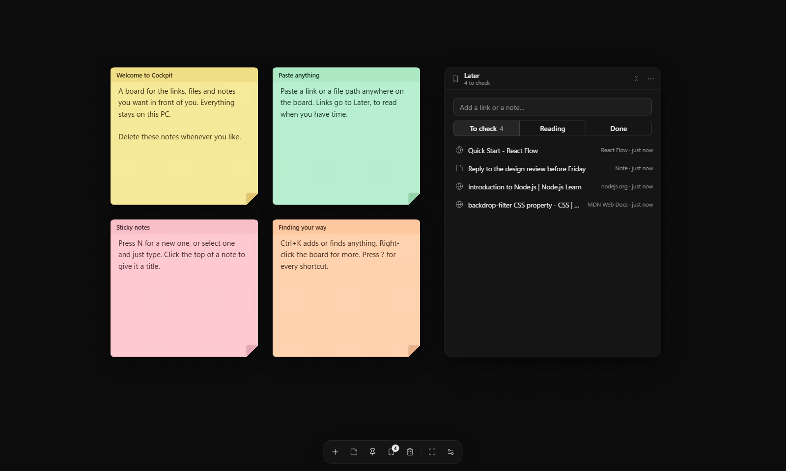

# Cockpit

A calm, free-form board for the things you want in front of you: links to read later, files, sticky notes, a
daily journal, snippets to copy, and what your AI agents make. Paste a link or a file path anywhere and it becomes
a card you can read, move, resize and put beside anything else.

It runs on your PC only (a small local server on `127.0.0.1`) and opens in its own window. Windows 10 and 11.



## Install

1. Download `Cockpit-<version>-win-x64.zip` from the [latest release](../../releases/latest).
2. Unzip it and double-click **Install.cmd**. No admin rights needed. Cockpit brings its own Node, so there's nothing
   else to install.
3. Open **Cockpit** from the Start menu, or press <kbd>Ctrl</kbd> <kbd>Alt</kbd> <kbd>K</kbd> from anywhere.

The installer puts Cockpit in `%LOCALAPPDATA%\Programs\Cockpit`, starts it at login, and (if you use Claude Code)
offers to connect the two. To remove Cockpit, run **Uninstall.cmd** in that folder; your notes and board are kept.

**Updates:** Cockpit checks GitHub for a new release about once a day. When there is one, a dot appears on the
Settings button; **Settings → Updates → Update now** downloads it, checks it against the checksum GitHub publishes,
and installs it. Your notes and board stay as they are. You can turn the daily check off in the same place.

Windows may warn that the installer is from an unknown publisher: the release isn't code-signed yet. Choose
**More info → Run anyway**, or build it yourself (see [Develop](#develop)).

## What it does

- **Paste anything.** A link goes to **Later** (to check, reading, done), read in the background so you can read
  it in Cockpit. A file path opens as a card: Markdown, code, CSV, JSON, diffs, images, PDF, audio and video, and
  Word, Excel and PowerPoint previews.
- **Sticky notes** (<kbd>N</kbd>): click and type. Five colours, a title if you want one. They're plain text
  files in your notes folder.
- **Journal** (<kbd>J</kbd>): one page a day. The card always shows today; earlier days are a click back and stay
  read-only until you unlock them.
- **Snippets** (<kbd>C</kbd>): things you copy often, one click each. Secrets are encrypted on disk with Windows'
  own data protection and hidden until revealed.
- **Quick access** (<kbd>Q</kbd>): your pins, plus what you open most. Its pin keeps it open beside the board.
  Drag a row from it (or from Later, Outputs or a folder card) onto the board to make it a card.
- **Today** (<kbd>T</kbd>): a simple to-do list on this PC, or today's Todoist tasks once you add your Todoist token
  in Settings.
- **Folders**: paste a folder's path and it's a card with its files as a tree; click a file to open it beside it.
- **The board**: drag, resize, fold, lock in place (<kbd>Ctrl</kbd> <kbd>Shift</kbd> <kbd>L</kbd>), tidy
  (<kbd>Ctrl</kbd> <kbd>Alt</kbd> <kbd>T</kbd>), undo (<kbd>Ctrl</kbd> <kbd>Z</kbd>). Right-click the board for
  the rest, <kbd>Ctrl</kbd> <kbd>K</kbd> to add or find anything, <kbd>?</kbd> for every shortcut.

## With Claude Code

Cockpit has an MCP server with two tools:

- `show`: puts a file, a web page, two files side by side, or written content (Markdown, HTML, code, a diagram)
  on your board, so long answers are read in a proper window instead of the chat.
- `snippet`: leaves something you'll copy (a command, a connection string, a key) in Snippets instead of the chat.

**Outputs** lists what each Claude Code turn made, one group per chat: the files it wrote or edited, files its reply
names that changed during the turn, drafts, commands and links. A small Claude Code hook (`server/claude/outputs-hook.js`,
a Stop hook in `~/.claude/settings.json`) does this. It reads only the end of the chat's transcript, writes to
Cockpit's inbox, and never blocks Claude.

The installer offers to connect both. To do it by hand:

```powershell
claude mcp add --scope user cockpit -- "$env:LOCALAPPDATA\Programs\Cockpit\runtime\node.exe" "$env:LOCALAPPDATA\Programs\Cockpit\app\server\mcp.js"
```

```powershell
& "$env:LOCALAPPDATA\Programs\Cockpit\runtime\node.exe" "$env:LOCALAPPDATA\Programs\Cockpit\app\scripts\claude-setup.mjs" add-hook --node "$env:LOCALAPPDATA\Programs\Cockpit\runtime\node.exe"
```

`remove-hook` takes the hook out again; nothing else in your Claude Code settings is touched.

The Outputs button appears in the dock once something has arrived. Any other program or agent can add to it too, by
writing a JSON file to `%USERPROFILE%\.cockpit\inbox\`:

```json
{
  "outputs": {
    "from": "Claude",
    "session": "chat-id",
    "cwd": "C:\\path\\to\\project",
    "items": [
      { "kind": "file", "target": "C:\\path\\to\\report.md", "label": "report.md" },
      { "kind": "link", "target": "https://example.com" },
      { "kind": "command", "text": "npm test", "label": "Run the tests" }
    ]
  }
}
```

`kind` is one of `file`, `link`, `draft`, `command` or `prompt`. The same folder takes `{ "path": "…" }`,
`{ "url": "…" }` or `{ "left": "…", "right": "…" }` to open one thing straight away.

## Where your things are

| What | Where |
| --- | --- |
| Notes, sticky notes, the journal, drafts | `Documents\Cockpit` (change it in Settings) |
| The board, settings, kept pages, snippets | `%USERPROFILE%\.cockpit` (a copy of the board is kept each day in `backups`) |
| The app | `%LOCALAPPDATA%\Programs\Cockpit` |

Notes are plain Markdown files, so any editor (and any agent) can read them.

## Privacy and safety

- The server listens on `127.0.0.1` only and refuses other hosts, other sites' origins and cross-site requests.
  Every change needs a custom header that a web page can't send.
- Nothing else is sent anywhere unless you ask for it: a link you save is fetched to read it, your Todoist token goes
  only to `api.todoist.com`, and the daily update check asks GitHub for the latest release (nothing about you goes
  with it; turn it off in Settings).
- HTML you open runs in a sandbox with no access to Cockpit.
- **Usage counts are opt-in.** After its first day Cockpit asks once whether it may send anonymous counts of how
  often features are used, once a day, with the version and Windows build, under a random id. Never what's on
  your board. Settings → Privacy shows exactly what's sent and turns it off. A build with no key in
  `package.json` (`cockpitTelemetry`), such as a fork, never asks and never sends. The code is
  `server/lib/telemetry.js`.
- See [SECURITY.md](SECURITY.md) to report a problem.

## Optional integrations

These stay out of the way until you set them up:

- **Todoist**: paste your API token in Settings.
- **Trackers**: `tracker.json` files from the tracker mod for Claude Code. One a Claude Code chat works in is added
  by itself (through the Outputs hook); Settings → Claude Code lists them, takes one off, and can look through
  Projects, Desktop and synced folders for more.
- **Journal sync over SSH** (`kokoroHost` in `.cockpit\config.json`): swaps journal pages with a self-hosted
  journal service through a restricted SSH key. See `server/lib/journal-sync.js` and `scripts/kokoro-gate.py`.

## Develop

You need Node 20 or later and Windows.

```powershell
git clone https://github.com/Zukizuk/cockpit.git
```

```powershell
cd cockpit; npm install
```

```powershell
npm run setup
```

`npm run setup` builds the app and runs your clone the way an installed copy runs: Start menu entry, server at
login, <kbd>Ctrl</kbd> <kbd>Alt</kbd> <kbd>K</kbd>, and optionally the Claude Code connection.

| Command | What it does |
| --- | --- |
| `npm start` | runs the server on <http://127.0.0.1:4790> |
| `npm run dev` | the web app with hot reload (talks to the running server) |
| `npm run build` | builds the web app into `web/dist`, which the server serves |
| `npm test` | server tests, against a temporary home folder |
| `npm run typecheck` | type-checks the web app |
| `npm run package` | builds the release zip in `release/` |

To try changes without touching your own board, run a second server with its own folders:

```powershell
$env:COCKPIT_PORT=4799; $env:COCKPIT_HOME="$env:TEMP\cockpit-test"; $env:COCKPIT_DATA="$env:TEMP\cockpit-test\.cockpit"; npm start
```

- `server/`: Node with no framework. `index.js` is the API; `lib/` has one module per feature; `mcp.js` is the MCP
  server.
- `web/`: React, Vite, Tailwind, shadcn/ui and React Flow (the board).
- `scripts/`: the launcher, the login start, the <kbd>Ctrl</kbd> <kbd>Alt</kbd> <kbd>K</kbd> helper (C#, built
  with Windows' own compiler), and the installer.

See [CONTRIBUTING.md](CONTRIBUTING.md) before opening a pull request.

## License

[MIT](LICENSE)
